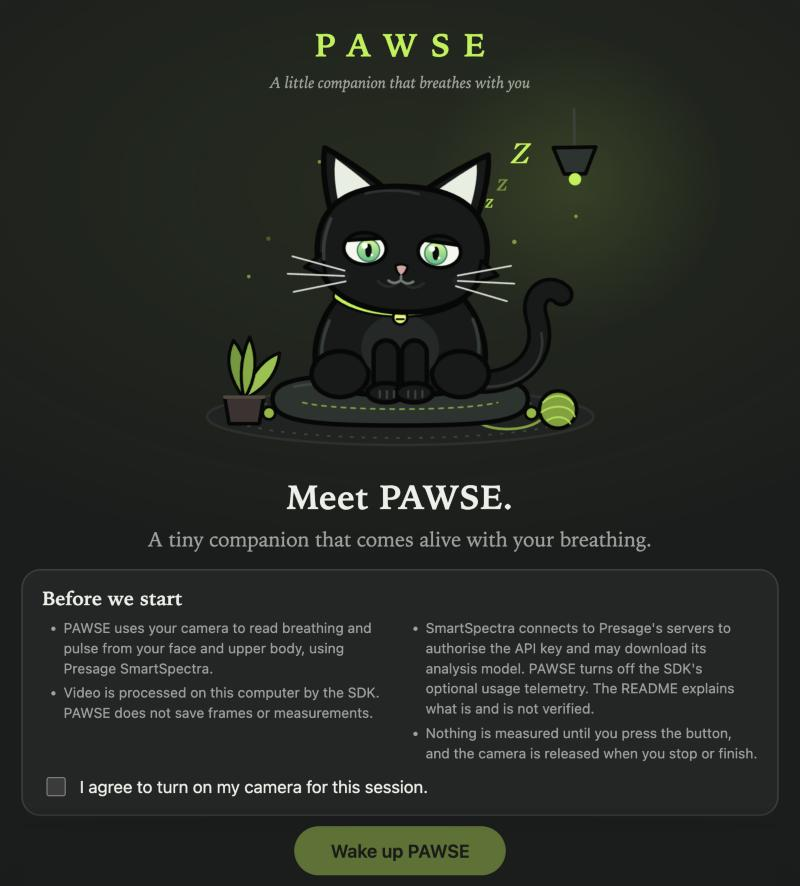
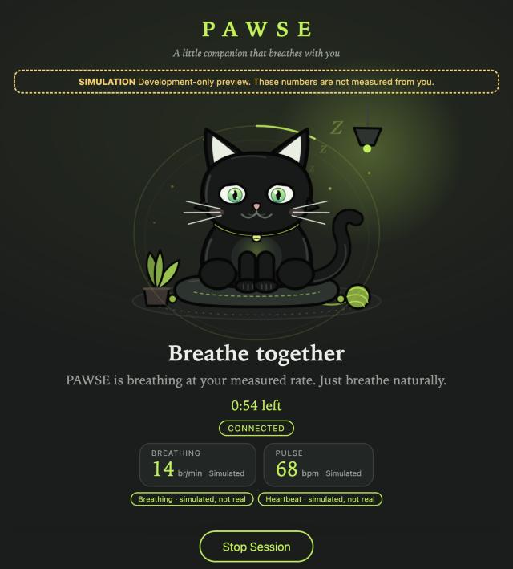
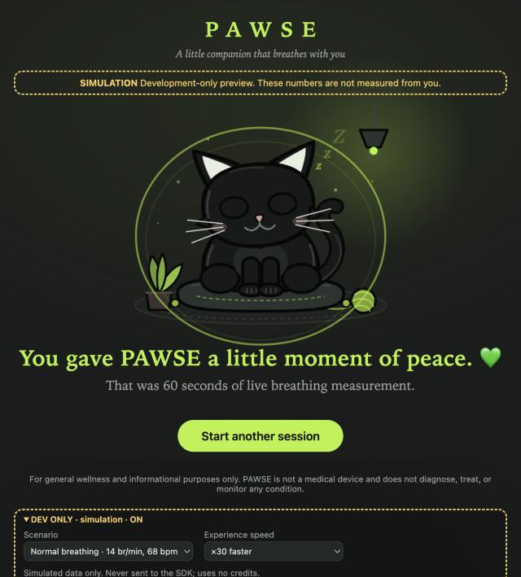
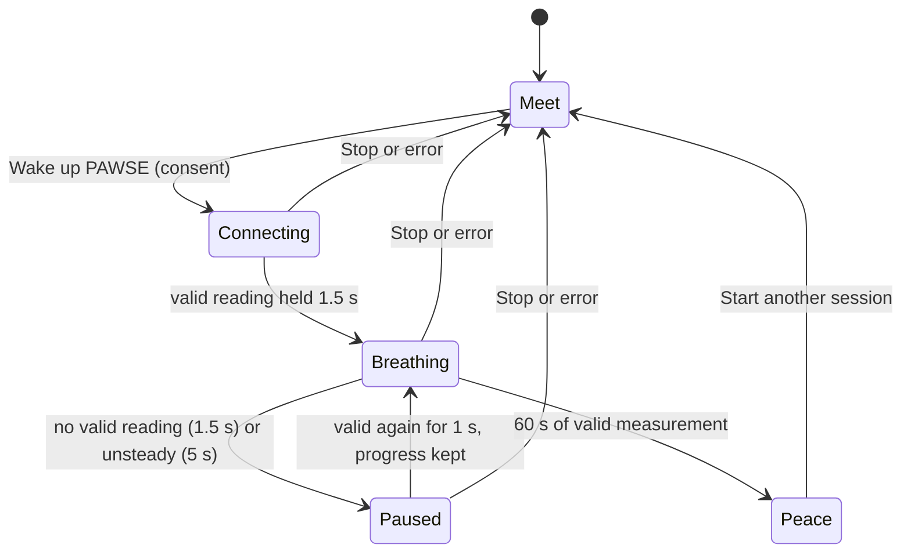
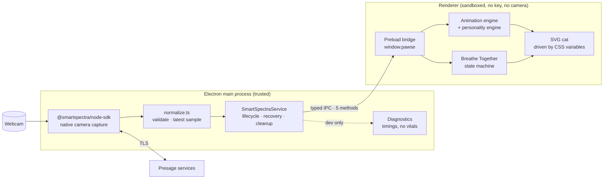
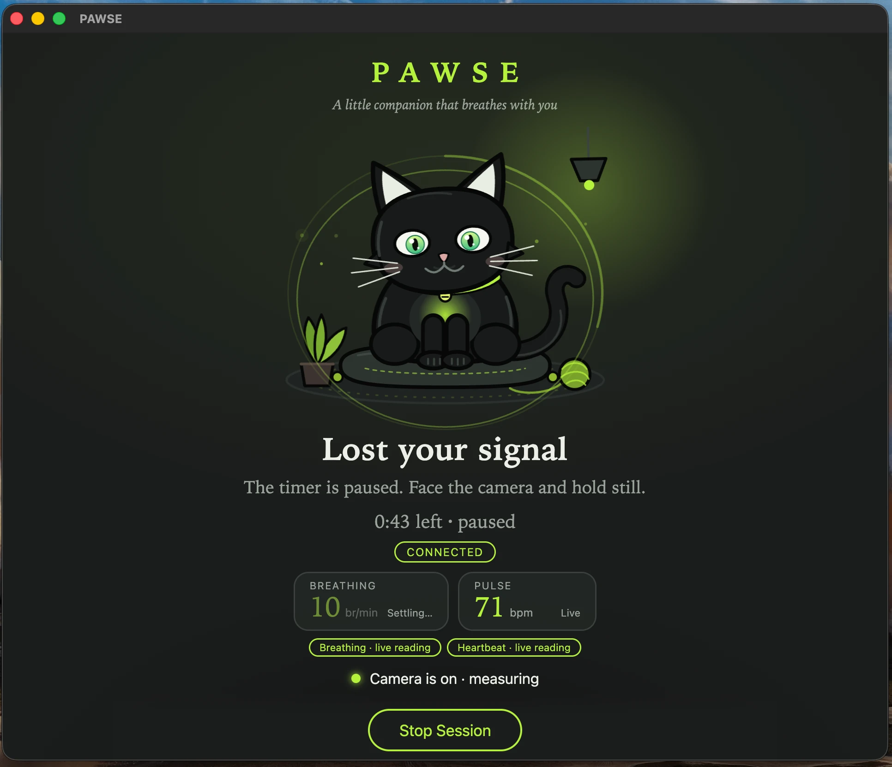

<div align="center">

# 🐾 PAWSE

### A little companion that breathes with you.

**Your breathing brings a tiny cat to life.** PAWSE reads your breathing rate and pulse from an ordinary webcam
with the [Presage SmartSpectra SDK](https://smartspectra.presagetech.com/) and lets a hand-drawn companion
breathe at *your* pace for one quiet minute.


[Experience](#-the-experience) ·
[Quick start](#-quick-start) ·
[How it works](#-how-it-works) ·
[Engineering](#-engineering) ·
[Privacy](#-privacy-and-responsible-use) ·
[Status](#-what-is-verified-and-what-is-not)

<br />

<table>
  <tr>
    <td align="center"></td>
    <td align="center"></td>
    <td align="center"></td>
  </tr>
  <tr>
    <td align="center"><sub><b>1 · Meet PAWSE</b><br />resting cat, plain consent</sub></td>
    <td align="center"><sub><b>3 · Breathe together</b><br />60 s ring · <i>simulated values</i></sub></td>
    <td align="center"><sub><b>4 · A little moment of peace</b><br />the cat settles · <i>simulated</i></sub></td>
  </tr>
</table>

<sub>Screens 3 and 4 were captured with the development-only simulation (no camera, no SDK, no credits) and say so on screen.
A capture from a real session is in [Real-device evidence](#real-device-evidence).</sub>

</div>

---

## 💚 Why PAWSE

Most biometric demos are dashboards. PAWSE is a **creature**. The idea fits in one sentence, and you should get it in ten
seconds of looking at the app:

> *Your breathing brings a little companion to life.*

- 🫁 **The belly is the heartbeat of the scene.** The cat breathes at the respiratory *rate* the SDK measures, glides when
  that rate changes, and stays put when it doesn't.
- 💓 **A soft chest glow follows your pulse rate.** Subtle, never a medical readout.
- 🐈 **It has a personality.** Curious glances, slow blinks, tail swishes, ear twitches and head tilts, seeded and
  budgeted so it feels organic rather than looped.
- 🤝 **It is honest.** The app tells you what is a live reading and what is decorative motion. It never scores your
  breathing, never infers stress or mood, and never claims a connection before it has a valid reading.

## ✨ The experience

**Breathe Together** is a 60-second journey in four stages:

| # | Stage | What happens |
| :-: | --- | --- |
| 1 | **Meet PAWSE** | The resting cat, a plain explanation of what the camera is used for, explicit consent, then **Wake up PAWSE**. |
| 2 | **Connecting** | The cat is curious. Friendly status lines come only from real session state ("Looking for you…", SDK hints such as *too dark*). |
| 3 | **Breathe together** | Starts once a **fresh, stable breathing reading** has held for 1.5 s. A thin ring tracks 60 s of *valid* measurement; small live readouts show the rate and pulse. Stop at any moment. |
| 4 | **A little moment of peace** | After 60 s of valid measurement the camera is released, the cat curls up with its eyes closed, a few hearts float up, and PAWSE says *"You gave PAWSE a little moment of peace. 💚"* |



**Rules that keep it honest**

- Completion is **elapsed valid measurement time**. There is no target rate, no score, and no comparison of values.
- No valid signal means no time is credited. A lost signal and an *unsteady* breathing reading are different situations and
  are worded differently (**Signal lost** / **Signal unstable**). The pill never says "Connected" while the timer is paused.
- Time is credited in steps of at most one second per tick, so a sleeping laptop or a throttled timer can't count as measurement.
- Failures (camera permission, exhausted credits, server unreachable, bad API key) return to the welcome screen with a
  plain-language explanation.

## 🚀 Quick start

**Prerequisites**

- macOS on Apple Silicon, Windows x64 or Linux x64/arm64 (glibc 2.35+), the platforms the SDK supports. *Development and
  testing so far happened on macOS arm64 only.*
- Node.js 20+ (developed on Node 24) and npm 11
- A webcam
- A SmartSpectra API key from <https://physiology.presagetech.com/>

```bash
git clone https://github.com/holasoymalva/pawse.git && cd pawse
npm ci                         # also downloads the Electron binary (postinstall)
cp .env.example .env           # then set SMARTSPECTRA_API_KEY=<your key>
npm run dev                    # development, hot reload, simulation + diagnostics available
npm start                      # production build (rebuilds, then launches)
```

> npm 11 blocks dependency install scripts until approved. `koffi` and `protobufjs` (required by the SDK) are already
> approved in `package.json`. Electron 45 no longer fetches its binary during install, so the project's own `postinstall`
> runs `install-electron`. If `node_modules/electron/dist` is still missing, run `npx install-electron`.

### macOS camera permission (read this before the first run)

The SDK captures from the camera in the Electron **main** process, so macOS asks for access on behalf of *the app that
launched it*.

- Launch from an app that can show its own camera prompt, for example the macOS **Terminal**. If Electron is spawned by
  another app (an IDE or a desktop assistant), macOS may attribute the request to that app and show no prompt; PAWSE
  then reports *"PAWSE can't use the camera"* after 45 s.
- If you declined earlier: **System Settings → Privacy & Security → Camera**, enable the launching app, restart PAWSE.
- Never run two instances at once: they compete for the camera (and for API credits).
- Windows and Linux need no extra permission setup. Packaged builds are **not done** yet (see [Roadmap](#-limitations-and-roadmap)).

### Scripts

| Script | Purpose |
| --- | --- |
| `npm run dev` | Development with hot reload |
| `npm run build` | Production build into `out/` |
| `npm start` | Run the production build |
| `npm run typecheck` | Strict TypeScript across the main/preload/shared and renderer projects |
| `npm run lint` | ESLint |
| `npm test` | Vitest (node and jsdom): 266 tests in 21 files at the time of writing |
| `npm run check:prod` | After a build: fails if the production bundle contains development-only simulation code |

## 🧠 How it works



**Data flow.** `metrics` (SDK) → decode → `breathing.rate[]` / `cardio.pulseRate[]`, latest valid sample → normalized
reading (`value`, `confidence`, `stable`: the SDK's own fields) → session state → IPC → hysteresis-filtered cat state →
deterministic engines → CSS variables on the SVG, written per frame without re-rendering React.

### Key design decisions

| Decision | Why | Trade-off |
| --- | --- | --- |
| **SDK runs in the Electron main process** with native camera capture | The official renderer integration needs the API key in the renderer bundle (the official sample hardcodes it). Main keeps the key out of the renderer, IPC and logs. | No in-app camera preview. |
| **Typed, minimal IPC** (`getState`, `start`, `stop`, `getDiagnostics`, `onState`) | The renderer can never reach `ipcRenderer`, the SDK, or the key. `start` requires `{ consent: true }`. | A little ceremony. |
| **Deterministic animation engines** (seeded RNG, fixed-step friendly) | Behaviour is testable: the same seed and inputs give identical frames, and rate-to-visual mapping is asserted in tests. | Motion is authored, not physical. |
| **Rate, not phase.** The cat follows the breathing *rate* | The SDK reports a rate estimate, not breath onsets. Anything else would imply a precision that doesn't exist. | Not synchronised to individual breaths. |
| **A new SDK instance per session**, always `stopAsync()` then `destroy()` | Releases the camera and native resources however a session ends. | Slightly slower restarts. |
| **Simulation is renderer-only and dev-only** | Visual work must never cost API credits or look like real data. | One more thing to guard (see tests). |

### SDK integration

- Metrics requested: `breathingMetrics` + `cardioMetrics`. Events: `processingStatus`, `validationStatus`, `metrics`, `error`.
- `metrics` buffers are decoded with `decodeMetrics` from `@smartspectra/node-sdk/messages`. PAWSE computes **no** confidence
  of its own; it passes through the SDK's `confidence` (0–100) and `stable` flag.
- `enableTelemetry: false` (see [Privacy](#-privacy-and-responsible-use)). LLM Insights are not used.

### Reliability

| Situation | Behaviour |
| --- | --- |
| Retryable SDK `error` | Session keeps running; a notice is shown and cleared when readings resume |
| SDK enters its error state | Up to 3 pipeline recoveries (`stopAsync` → `reset` → `start`, backoff 0.75 s × attempt), budget restored after 30 s of healthy data, then `RecoveryFailed` |
| Non-retryable SDK `error` | Session fails, SDK destroyed, error explained |
| Undecodable metrics packet | Ignored; 5 in a row fail the session |
| Stop while waiting for the camera prompt, or during a recovery backoff | Cancels cleanly; no SDK is created / no reset runs |
| App quit | `dispose()` stops and destroys the SDK |

## 🧪 Engineering

PAWSE is built to be **verifiable**, not just demoable.

- **266 automated tests** across the domain, the SDK service (with a fake SDK), IPC and preload, both animation engines,
  the experience state machine, and the UI (jsdom, including full 60-second journeys on a controlled clock).
- **Quality gates**: strict TypeScript, ESLint, `npm test`, a production build, and `npm run check:prod`.
- **Static guards** (`src/tooling/guards.test.ts`): the dev simulation can only be reached behind `import.meta.env.DEV`; no
  fixed-position dev UI; every CSS animation is switched off under `prefers-reduced-motion`.
- **Supply chain**: `npm audit` is clean (a dev-only `minimatch` advisory is resolved by an override).

```
src/
├── shared/        pure, DOM-free, heavily tested
│   ├── signal.ts · diagnostics.ts · ipc.ts     domain model and typed IPC contract
│   ├── animation/      engine · personality · hysteresis · CSS-variable mapping
│   └── experience/     "Breathe Together" state machine and copy
├── main/          Electron main: SDK service, normalization, diagnostics, config, IPC handlers
├── preload/       contextBridge: window.pawse (typed, minimal)
├── renderer/      React UI, SVG cat scene, hooks (+ dev/ simulation, dev-only)
└── tooling/       static guards over the renderer source and stylesheet
scripts/           check-prod-bundle.mjs
docs/images/       screenshots used in this README
```

### Development tools

- **Simulation** (`npm run dev`, panel **DEV ONLY · simulation** at the bottom of the page, collapsed by default): breathing
  presets (slow 8, normal 14, fast 22 br/min), situations (settling, searching, signal lost, resting, errors including
  exhausted credits) and a speed multiplier (×1 to ×60) to preview the whole journey quickly. It runs entirely in the renderer,
  is labelled *simulated, not real* everywhere, cannot start a camera session, and stops any real session before it takes over.
- **Diagnostics** (`npm run dev`, press **⌘/Ctrl+Shift+D**): packet and reading intervals, time to first reading, `stable`
  flips, stale transitions, validation codes, SDK errors, recoveries. *Copy report* produces JSON with timings and counts
  only, never vital-sign values, frames or keys (enforced by a test). Unavailable in packaged builds.
- The renderer also opens in a plain browser at the dev-server URL with an inert stub, for visual work without Electron.

### Accessibility

The cat is a real button (*"Pet PAWSE"*) with an accessible name that describes its state; decorative scenery is
`aria-hidden`; the state pill is a live status; focus rings are visible; the layout is responsive (checked at 375 px);
`prefers-reduced-motion` scales JavaScript motion to 40 % and stops the CSS ambient animations.

## 🔒 Privacy and responsible use

**For general wellness and informational purposes only.** PAWSE is not a medical device. It does not diagnose, treat or
monitor any condition, does not score your breathing, and makes **no** stress or emotion inferences. The cat's expressions
describe the *app's state*, never the user's.

**What PAWSE itself does**

- Nothing starts without explicit consent and a button press; the camera is released on stop, on completion and on quit.
- Frames and measurements are **not stored**; values live in memory during a session. (Electron keeps its usual Chromium
  profile under the app's user-data folder; that is not measurement data.)
- `enableTelemetry: false`. Per the SmartSpectra docs, telemetry would be an optional once-per-session aggregate summary
  (SDK/runtime info, performance and quality counters) that excludes raw frames, metric values and identifiers.
- The API key is read only by the main process, from a git-ignored `.env`. It never reaches the renderer, IPC or logs
  (SDK error text is redacted before display).

**What the SDK does that PAWSE does not control**: as far as we could establish

- **The SDK talks to Presage services during a session.** In a development run, PAWSE's main process held an established
  TLS connection to `76.223.65.59:443`, which `cont-api.physiology.presagetech.com` resolves to (checked with `lsof` and
  DNS). Strings in the SDK's native library also reference AWS Cognito and other `*.physiology.presagetech.com` hosts.
- **"Falling back to remote delivery."** The log line `Unable to resolve configured model path. Falling back to remote
  delivery if available.` comes from the SDK's physiology inference step. The npm package ships face and pose models but
  no physiology model, and the library mentions "device key provisioning" and "remote EMD model delivery", including
  `device_id is required for remote model download`. Our reading: on first use the SDK may download its physiology model
  after provisioning a device key tied to a device identifier. The official docs mention remote model delivery only as a
  build option and don't describe it further.
- **So it would be inaccurate to say the network is used only to validate the API key.** Authentication, device
  provisioning and model delivery all appear to use it.
- **Whether camera frames or derived signals leave the device was not verified.** The channel is TLS (the docs describe it as
  TLS-pinned), so its contents can't be inspected without defeating that protection. The documentation says metrics are
  computed on-device and that raw video and facial imagery are never transmitted. We have no evidence contradicting that
  and none confirming it for the core metrics path. If this matters for your use, ask Presage (support@presagetech.com)
  what exactly is exchanged during authentication, device provisioning and model delivery.

To see which hosts a running session talks to (hosts only, never contents):

```bash
lsof -nP -i -a -c Electron | grep ESTABLISHED
```

## ✅ What is verified, and what is not

| Area | Status | Evidence |
| --- | --- | --- |
| Domain normalization, config parsing, diagnostics math | ✅ Tested | unit tests |
| SDK service lifecycle, cleanup, cancellation, recovery, malformed packets | ✅ Tested **with a fake SDK** | unit tests |
| IPC consent gate, channel set, preload surface | ✅ Tested | unit tests |
| Animation engine, personality, hysteresis, rate → visual mapping | ✅ Tested | unit tests, incl. belly cycles and glow pulses per minute at a simulated 60 fps |
| "Breathe Together": transitions, 60 s timer accuracy, pause/resume, unsteady vs lost, cancellation, camera release | ✅ Tested | state-machine tests; UI tests on a controlled clock (real-session API stubbed) |
| Errors: camera permission, credits exhausted, server, API key | ✅ Tested with *simulated/stubbed* errors | UI tests; not triggered by the real SDK |
| Simulation isolation and production exclusion | ✅ Tested | UI tests, static guards, `check:prod` (with a negative control) |
| Reduced motion | ✅ CSS coverage tested; ⚠️ not checked against a real OS setting | static guard test |
| Native SDK loads on macOS arm64; the camera is listed | ✅ Verified once | script on the dev machine |
| **Live readings reach the production app on a real camera** | ✅ Shown in a real-session screenshot supplied by the project owner (below) | one capture; no diagnostics report yet |
| Real metrics cadence, `stable` behaviour, stale frequency | ❓ **Unverified** | needs a session with the diagnostics panel |
| The full 60-second journey with a real camera | ❓ **Unverified** | needs a real session |
| Recovery from real SDK errors | ❓ **Unverified** | never triggered with the real SDK |
| Cat motion timing in a real Electron window | ❓ **Not measured** | the preview pane used for visual checks was throttled |
| What data leaves the device | ❓ **Not verified** | see [Privacy](#-privacy-and-responsible-use) |
| Windows, Linux, packaged builds | ❌ **Not tested** | |

### Real-device evidence

<p align="center">
  
</p>

*A real session of the production build on macOS (camera on, no simulation): the SDK delivers a live pulse (71 bpm) and a
breathing reading (10 br/min) that is still settling. This capture also exposed a wording bug that is now fixed: it
shows "Lost your signal" and "Connected" together while only the breathing reading was unsteady. Today that situation reads
**"Breathing is settling"** with a **"Signal unstable"** pill, and the timer tolerates up to 5 s of unsteadiness before pausing.
The 5 s value is an estimate from a single observation and should be calibrated with a diagnostics report.*

### Manual verification with a real camera

1. `npm run dev` from an app with camera permission; consent; **Wake up PAWSE**.
2. Sit 0.5–1 m away, face the camera, even light, stay still. Press **⌘/Ctrl+Shift+D** and let it run ≥ 3 minutes.
3. Both chips should read *live reading* once readings are stable. Compare the cat's cycle with the "breath cycle" line
   in the panel (= 60 / current rate).
4. Cover the camera for ~20 s: expect **Signal lost**, then recovery when you uncover it.
5. *Copy report* for the JSON; **Stop Session** and check the camera light goes off.

## 🛠 Troubleshooting

| Symptom | Cause and fix |
| --- | --- |
| *"PAWSE can't use the camera"* | macOS attributed the permission request to the launching app. Launch from the macOS Terminal, or enable that app under Privacy & Security → Camera, then restart. |
| *"SmartSpectra credits used up"* | The SDK answered `402 Insufficient credits`. Check the plan at physiology.presagetech.com. Avoid leaving sessions open or running duplicate instances. |
| *"API key missing"* | Copy `.env.example` to `.env` and set `SMARTSPECTRA_API_KEY`, then restart. |
| `node_modules/electron/dist` missing | `npx install-electron` |
| Dev server says *"Port 5173 is in use"* | Another instance is still running. Stop it before starting a new one. |

## 🗺 Limitations and roadmap

- **Not validated end to end with a camera** beyond the single capture above; calibrate the stability grace, plausibility
  ranges and the 10 s staleness threshold with real diagnostics.
- **Breathing is required** for the timed session (the cat breathes at *your respiratory rate*); a pulse alone does not start it.
- **No "taking a while" hint** while connecting: a session that never finds a signal stays open until stopped.
- **Packaging and distribution** are out of scope for now (hardened runtime, `NSCameraUsageDescription`, bundling the
  native library). An API key inside a distributed app is not safe; a public release would need another flow.
- **License**: not yet specified. The Presage SmartSpectra SDK is subject to its own license (see its package).

## 🙏 Acknowledgements

Built for the **Presage SmartSpectra SDK Challenge** (deadline November 22, 2026) with the
[Presage SmartSpectra SDK](https://smartspectra.presagetech.com/), [Electron](https://www.electronjs.org/),
[React](https://react.dev/), [Vite](https://vite.dev/) and [Vitest](https://vitest.dev/). The cat, its scene and all
animation are original SVG and CSS: no images and no animation library. Developed with the assistance of
[Claude Code](https://claude.com/claude-code).

<div align="center"><sub>Made with care, and with a little bit of breathing. 💚</sub></div>
